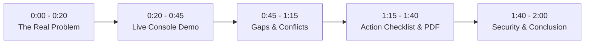

# BLINDSPOT — 2-Minute Hackathon Demo Video Script
**Platform:** [blindspot-ruby-omega.vercel.app](https://blindspot-ruby-omega.vercel.app)  
**Hackathon Track:** Digital Dark Spot (AI-Assisted Information Gap Detection)

---

## Video Timeline & Action Guide

---

### [0:00 – 0:20] THE HOOK & THE REAL PROBLEM

**Screen Action:**
- Open the live homepage: `https://blindspot-ruby-omega.vercel.app`.
- Show the hero banner: *"Find the gaps behind the answers."*

**Voiceover (Clear, conversational & confident):**
> "When people make life-changing decisions—like applying for a scholarship, understanding admission rules, or researching government policies—they turn to search engines and AI chatbots.
> 
> But here is the dangerous truth: according to a 2025 empirical study published in the *Journal of Empirical Legal Studies*, leading AI research tools hallucinate or provide misleading information in **17 to 33%** of factual queries. 
> 
> Typical AI tools summarize what is present, but quietly invent or ignore what is **missing**, **conflicting**, or **outdated**."

---

### [0:20 – 0:45] THE SOLUTION — LIVE INPUT DEMO

**Screen Action:**
- Scroll smoothly down to the **Investigation Console**.
- Click the button: **`Preset 1: Gates Cambridge`**.
- Show the question automatically populated: *"What are the eligibility criteria, application deadlines, and renewal requirements for the Gates Cambridge Scholarship?"*
- Hover over the 3 source URLs.
- Click the button: **`INVESTIGATE SOURCES →`**.

**Voiceover:**
> "Meet **Blindspot**—an AI-assisted intelligence auditor built specifically to solve this digital dark spot.
> 
> Blindspot is not a chatbot; it's an evidence auditor. You give it your research question and up to 10 source URLs. 
> 
> Here, we are testing the official Gates Cambridge scholarship across three official pages. Let's hit *Investigate Sources*."

---

### [0:45 – 1:15] CORE PROOF — GAPS & CONTRADICTIONS

**Screen Action:**
- The audit report loads.
- Highlight the **At-a-Glance Takeaways** (3-second briefing: Potential Gap, Possible Conflict, Verify Next).
- Click on the **GAPS** tab.
- Hover over Gap 1: *"Renewal requirements for multi-year scholars: Not Found in Reviewed Sources"*.
- Switch to the **CONFLICTS** tab (0 material conflicts, consensus verified).

**Voiceover:**
> "Within seconds, Blindspot delivers an evidence-grounded audit. 
> 
> First, notice the **At-a-Glance Takeaways** matching Section 3 of the hackathon problem statement. 
> 
> Now look at the **Gaps Audit**: typical AI would invent generic renewal conditions from model memory. Blindspot strictly scopes evidence to the reviewed corpus: it explicitly flags that renewal criteria for multi-year funding are **not found in the reviewed sources**, marks it as High Priority, and explains *why this matters*.
> 
> In the Conflicts section, if two sources disagree on documents or dates, Blindspot extracts verified bilateral quotes side-by-side without smoothing them over."

---

### [1:15 – 1:40] FROM GAP TO ACTION — CHECKLIST & PDF REPORT

**Screen Action:**
- Click on the **CHECKLIST** tab.
- Click the interactive checkbox on Task 1 (strikes through and marks verified).
- Click the button: **`EXPORT PDF REPORT`** at the top right.
- Show the downloaded publication-ready PDF opening on screen.
- Click **`Launch Webpage Reader`** in the Source Rail to show the DOM inspection modal.

**Voiceover:**
> "Blindspot doesn't just say 'something is missing.' It turns every gap into an actionable **Verification Checklist**—telling you exactly which primary authority or handbook to consult, why it's critical, and how to verify it.
> 
> With a single click, users can **Export a Publication-Grade PDF Report** complete with executive audit verdicts, citations, and source metadata for submission or archival.
> 
> Users can also open the built-in **Webpage Reader** to inspect the raw extracted text of any source directly."

---

### [1:40 – 2:00] ARCHITECTURE, SECURITY & CLOSING

**Screen Action:**
- Switch back to the clean landing page or show the right rail telemetry.
- Show the GitHub repository README with 56 passing tests.

**Voiceover:**
> "Behind the scenes, Blindspot runs on a production stack: **React 19 and TypeScript** on the frontend, **FastAPI and Python** on the backend, powered by **Google Gemini 2.5 Flash** with strict JSON schemas. 
> 
> It includes enterprise security: SSRF defense blocking private IP spaces, IP rate limiting, and 56 passing automated tests.
> 
> In high-stakes decisions, knowing what your sources *didn't* tell you is just as important as knowing what they did. Blindspot turns digital dark spots into verified truth. 
> 
> Thank you!"

---

## Quick Recording Tips for Best Marks

1. **Resolution:** Record in 1080p full screen (use Windows Game Bar `Win + G` or OBS Studio).
2. **Audio:** Speak slowly and clearly with a quiet background.
3. **Pacing:** Let the mouse clicks be smooth—no rapid erratic scrolling.
4. **YouTube Upload:** Set video visibility to **Unlisted** and paste the link into the Unstop submission form.

